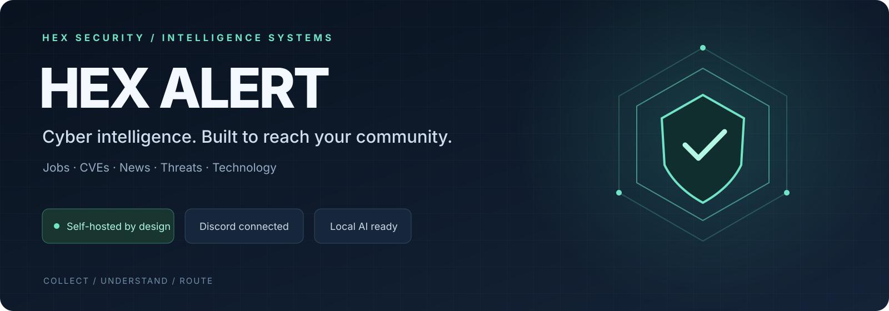
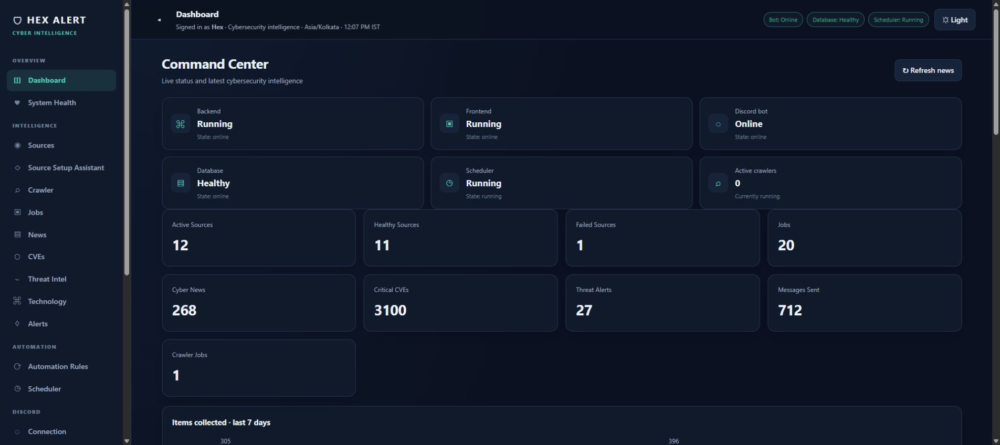
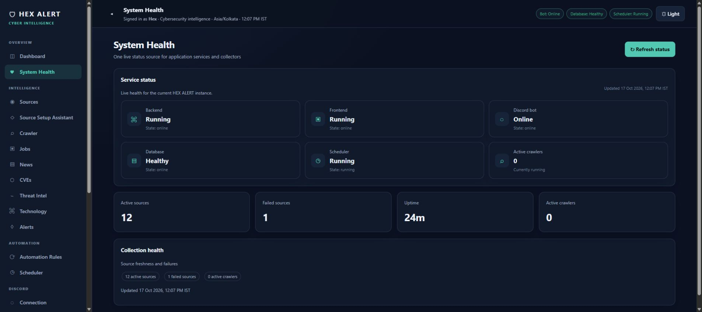
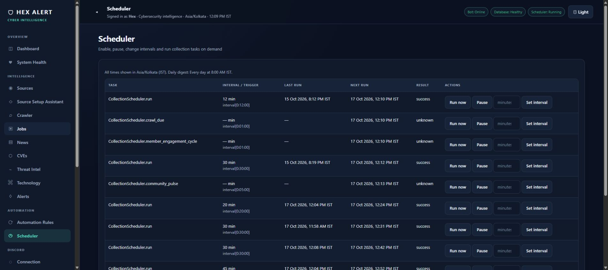
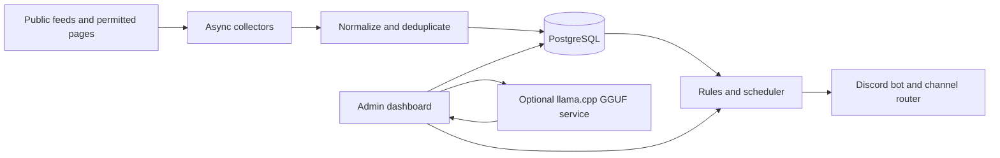

<p align="center"></p>

<p align="center">
  <a href="https://github.com/hexalpha/HEX-ALERT/actions/workflows/ci.yml"></a>
  
  
  
  
  
</p>

<p align="center"><a href="#quick-start-with-docker">Get started</a> · <a href="docs/SHOWCASE.md">Screenshot tour</a> · <a href="docs/FEATURES.md">Feature guide</a> · <a href="docs/INSTALLATION.md">Installation</a> · <a href="docs/VERIFICATION.md">Verification</a></p>

# HEX ALERT

**Cybersecurity intelligence, job discovery, and Discord alerting — by HEX SECURITY.**

HEX ALERT is a self-hosted security operations dashboard and Discord bot. It collects configured public feeds, organizes cybersecurity jobs and intelligence, and routes reviewed alerts to Discord. An optional local GGUF service powers HEX ALPHA, the built-in cybersecurity assistant.

**One workflow: collect → understand → route.** Keep public security intelligence, cybersecurity job discovery, source health and Discord delivery in a workspace you control.

> **Active development / source preview.** Bring your own Discord application, permitted feeds and optional model. Test mode is the default. This publication does not certify a deployment as production-ready.

## Features

- **Security intelligence:** RSS/Atom, public JSON and permitted public pages for news, vulnerabilities, threat intelligence, technology and jobs.
- **Discord delivery:** Slash commands, category-based channel routing, test alerts, delivery history, and permission checks.
- **Admin dashboard:** Source management, bounded crawler, scheduler, alert history, system health, automation rules, logs, backups, and account security.
- **Job discovery:** Public job feeds and supported public employer-board adapters, with normalization, freshness, filtering, and deduplication.
- **Local AI:** Optional isolated `llama.cpp` service for a GGUF model. HEX ALPHA is the user-facing assistant identity; the underlying model remains identified accurately in technical settings.
- **Security controls:** Encrypted runtime credentials, non-root application container, bounded and validated crawling, and explicit test-mode safeguards.
- **Windows control center:** Native Windows Forms launcher for Docker Compose start, stop, restart, health checks, and tray controls. The legacy Python launcher source is retained.

## Inside the dashboard



*Real running dashboard, captured October 17, 2026. Counts and health reflect that installation at capture time. A fresh installation starts with its own data. The header artwork is an original vector graphic; the UI captures are genuine.*

<details>
<summary><strong>System health and scheduler</strong></summary>





</details>

Explore the [screenshot tour](docs/SHOWCASE.md) and [complete feature guide](docs/FEATURES.md).

## Architecture



The Compose stack contains the application/dashboard and Discord bot, PostgreSQL, and an optional Local GGUF inference service. PostgreSQL, encrypted runtime configuration, backups, and model state use persistent volumes. The GGUF file is mounted read-only from the host and is not copied into the container image.

## Requirements

- Docker Desktop with Docker Compose v2
- Discord application and bot, if Discord delivery is required
- A permitted source feed or API
- Optional: a compatible GGUF model file and sufficient memory for local inference
- Optional development: Python 3.12+ (the packaged launcher does not require Python)

## Quick start with Docker

Start the dashboard, database, scheduler and Discord service:

```powershell
git clone https://github.com/hexalpha/HEX-ALERT.git
cd HEX-ALERT
python scripts/setup_local.py
docker compose build bot
docker compose up -d db config-init bot
```

The setup helper creates random local secrets without displaying them and preserves an existing `.env`. Without Python, use the Windows launcher or follow the manual configuration instructions in the [installation guide](docs/INSTALLATION.md).

Open **http://127.0.0.1:8080** → create an admin account → configure sources and Discord → review channel mappings. Keep **TEST_MODE=true** while validating routes.

For optional Local GGUF, supply your own compatible `CyberSecurity.gguf` in the project root, then start `docker compose up -d --build llm`. **No model weights are published here.** The host file is mounted read-only and excluded from Git and Docker build context. See [Local AI Guide](LOCAL%20AI%20GUIDE.md).

Check service health and logs:

```powershell
docker compose ps
Invoke-RestMethod http://127.0.0.1:8080/health
docker compose logs --tail=100 bot
```

Stop without removing persistent data:

```powershell
docker compose stop
```

Do not use `docker compose down -v` for routine shutdown; it removes named data volumes.

## Windows launcher

The launcher source is in `launcher/`. With Docker Desktop installed, build with `.\launcher\build.ps1`, then double-click `dist\HEX-ALERT.exe`. The native launcher controls the existing Compose stack; Docker remains a prerequisite. Model weights and Docker images are not bundled. See [LAUNCHER GUIDE.md](LAUNCHER%20GUIDE.md).

## Discord setup

Create a Discord application and bot in the Discord Developer Portal. Invite it with the `bot` and `applications.commands` scopes and only the channel permissions needed for your setup: View Channel, Send Messages, Embed Links, and Read Message History. Administrator permission is not required.

In the dashboard, open **Discord → Connection**, enter the bot token, test the connection, select the server and channels, then save. Tokens are encrypted in persistent runtime configuration; channel mappings are stored in PostgreSQL. The token is masked and is not returned by the configuration API. Do not put a token in an issue, screenshot, commit, or chat.

Slash commands and outgoing alerts do not require Message Content intent. Only enable privileged Discord intents if you explicitly configure features that need them, and enable the matching intent in the Developer Portal.

## Local development and tests

Python 3.12+ is recommended. Install development dependencies and run the suite:

```powershell
py -3.12 -m venv .venv
.venv\Scripts\Activate.ps1
python -m pip install -r requirements-dev.txt
python -m pytest -v
```

Additional checks:

```powershell
python -m compileall -q api bot collectors config database launcher llm services scripts
docker compose config --quiet
```

The automated tests include API/auth, database models and migrations, source normalization, routing, backup safety, MFA, crawler safety, and local HTTP fixtures. Live Discord delivery requires a real bot token, server, and channel. Live PostgreSQL and model checks require the corresponding services and local configuration.

## Project map

```text
api/             FastAPI routes and the existing admin dashboard
bot/             Discord connection, slash commands and embed rendering
collectors/      Jobs, news, CVEs, threats, technology and bounded crawling
services/        Routing, scheduling, retrieval, AI and community automation
database/        SQLAlchemy models, repository functions and Alembic migrations
config/          Validated settings and encrypted runtime storage
llm/             Isolated persistent GGUF inference service (no weights)
launcher/        Windows control center source and build tools
scripts/         Safe local setup and benchmark utilities
tests/           Automated regression coverage
docs/            Installation, feature guide, screenshots and verification
```

## Documentation

| Guide | Read it for |
| --- | --- |
| [Installation & operations](docs/INSTALLATION.md) | Fresh setup, secrets, data persistence and troubleshooting |
| [Feature guide](docs/FEATURES.md) | Supported workflows, source rules and test-mode behavior |
| [Screenshot tour](docs/SHOWCASE.md) | Actual dashboard, jobs, scheduler and health views |
| [Publication verification](docs/VERIFICATION.md) | Checks performed and current boundaries |
| [Windows launcher](LAUNCHER%20GUIDE.md) | Start, stop, tray, startup and local builds |
| [Local AI](LOCAL%20AI%20GUIDE.md) | Provider settings, local inference and hardware considerations |
| [Contributing](CONTRIBUTING.md) / [Security](SECURITY.md) | Safe issues, development and security reporting |

## Configuration and privacy

- Start from `.env.example`; set your own unique secrets locally.
- `.env`, database files, runtime configuration, backups, logs, generated binaries, test artifacts, and `*.gguf` files are excluded from version control.
- Preserve `SESSION_SECRET` between restarts: encrypted runtime credentials depend on it. Store it securely and include protected runtime configuration in your own backup plan.
- Do not upload a database dump, backup ZIP, production log, or screenshot containing private data.
- Configure only public sources you are permitted to access. HEX ALERT does not bypass authentication, CAPTCHAs, or anti-bot controls.
- AI external providers are optional. Do not enable external fallback unless you intend prompts to leave your installation.

## Known boundaries

- Source availability, public feed terms, Discord permissions, and local hardware determine which features are operational in each deployment.
- Local GGUF inference needs a compatible model supplied by the operator; model weights are not included.
- A real Discord end-to-end validation cannot be represented by unit tests alone.
- Historical audit and readiness reports from the development installation are not included in this public source set; validate current status in your own deployment.

## Security reporting

Do not publish credentials, vulnerable live endpoints, or private deployment data in public issues. See [SECURITY.md](SECURITY.md) for safe reporting guidance.

## License

No license is included. All rights remain with their respective owners until the project owner selects and adds a license.
