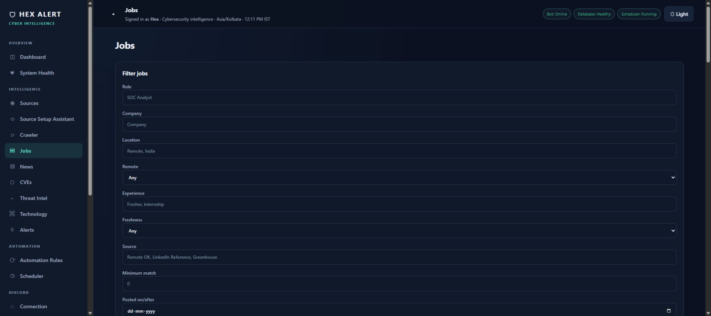

# HEX ALERT — screenshot tour

These are actual browser captures from the running local application on October 17, 2026. They have not been recreated as mockups. The captures show selected non-secret views; account credentials, private Discord conversations and raw operational logs are excluded.

## Command center

One overview for services, sources, jobs, vulnerabilities and delivery counts.

## System health

The running installation reported its backend, frontend, Discord bot, PostgreSQL and scheduler online. The source failure count remains visible rather than being hidden for the showcase.

## Collection scheduler

Review collection intervals, last runs, next runs and results. Controls can pause or trigger a task; no control was activated to create this screenshot.

## Jobs workspace

Filter by role, company, location, experience, source, freshness and match. Stored listings retain their source facts, including older dates and unknown fields. A listing appearing in the table is not a claim that it is a current high-fit recommendation.

## Reading the captures

Counts represent this installation, not bundled example records. Fresh clones use their own database. Source availability changes over time, and a green service health indicator does not mean every integration or production scenario has been independently validated. See [verification notes](VERIFICATION.md).
